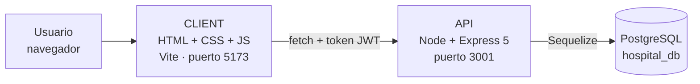
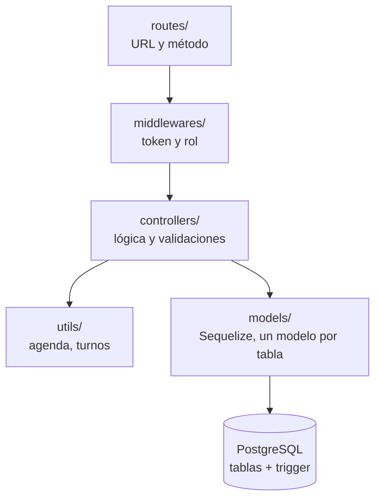
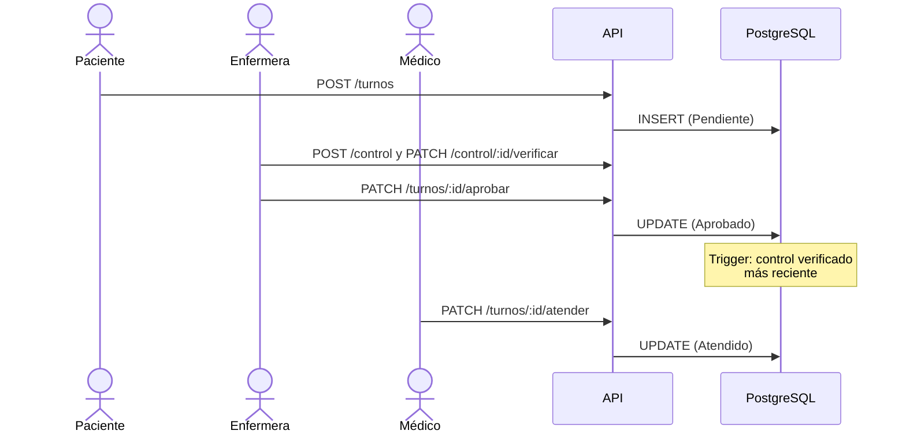

# Arquitectura

## Vista general

Tres partes independientes: cada una se puede iniciar, probar y desplegar por separado.

## Capas de la API

| Capa | Carpeta | Responsabilidad |
|---|---|---|
| Configuración | `src/config/` | Conexión a la base con los datos del `.env` |
| Rutas | `src/routes/` | Qué URL llama a qué función y con qué permisos |
| Middlewares | `src/middlewares/` | Verificar token y rol; convertir errores en mensajes |
| Controladores | `src/controllers/` | Validar datos y aplicar las reglas |
| Utilidades | `src/utils/` | Cálculo de horarios libres y cupos con prioridad |
| Modelos | `src/models/` | Tablas, tipos, validaciones y relaciones |
| Base de datos | `src/database/` | Crear la base, el trigger y los datos iniciales |

## Recorrido de un pedido

Ejemplo: la enfermera aprueba un turno.

1. **CLIENT** → `PATCH /turnos/5/aprobar` con el token.
2. **routes/turnos.js** → exige rol `enfermero`.
3. **middlewares/auth.js** → valida el token y el rol.
4. **turnoController.aprobar** → controla que el turno esté *Pendiente* y que el consultorio exista.
5. **Modelo Turno** → `UPDATE turno SET estado = 'Aprobado'`.
6. **Trigger** → busca el control verificado más reciente; si no hay, lanza error.
7. **errores.js** → si hubo error, responde 400 con el mensaje de la regla.
8. **CLIENT** → muestra el aviso y actualiza la tabla.

## Flujo completo de un turno

Estados: `Pendiente → Aprobado → Atendido`. Desde *Pendiente* o *Aprobado* puede pasar a `Cancelado`.

## Tecnologías y por qué las elegimos

| Tecnología | Uso | Por qué |
|---|---|---|
| Node.js + Express 5 | API REST | JavaScript en front y back; liviano y muy usado |
| Sequelize 6 | ORM | Un modelo por tabla y relaciones en código, como pidió el profesor |
| PostgreSQL 16 | Base de datos | Relacional, gratis, con triggers e índices parciales |
| bcryptjs | Contraseñas | Guarda solo el hash |
| jsonwebtoken | Sesión | La API no guarda estado; sirve igual en local y en Render |
| cors, morgan, dotenv | Utilidades | Permitir el CLIENT, registrar pedidos, separar la configuración |
| nodemon | Desarrollo | Reinicia la API al guardar |
| Vite | CLIENT | Servidor rápido y variables de entorno (`VITE_API_URL`) |
| GitHub | Código | 2 repositorios, ramas y Pull Requests |
| Render | Despliegue | Base, API y sitio gratis con `render.yaml` |

## Decisiones técnicas

| Decisión | Motivo |
|---|---|
| Una sola tabla `persona` + `persona_rol` | No duplicar datos; una persona puede tener varios roles |
| Regla 1 en un trigger | Se cumple aunque se edite la base desde pgAdmin |
| 2 cupos reservados por médico y día | Garantiza la Regla 2 |
| Bloqueo al crear un turno | Dos pacientes no toman el mismo horario |
| `sync()` en vez de `sync({ alter: true })` | `alter` duplicaba índices en cada reinicio |
