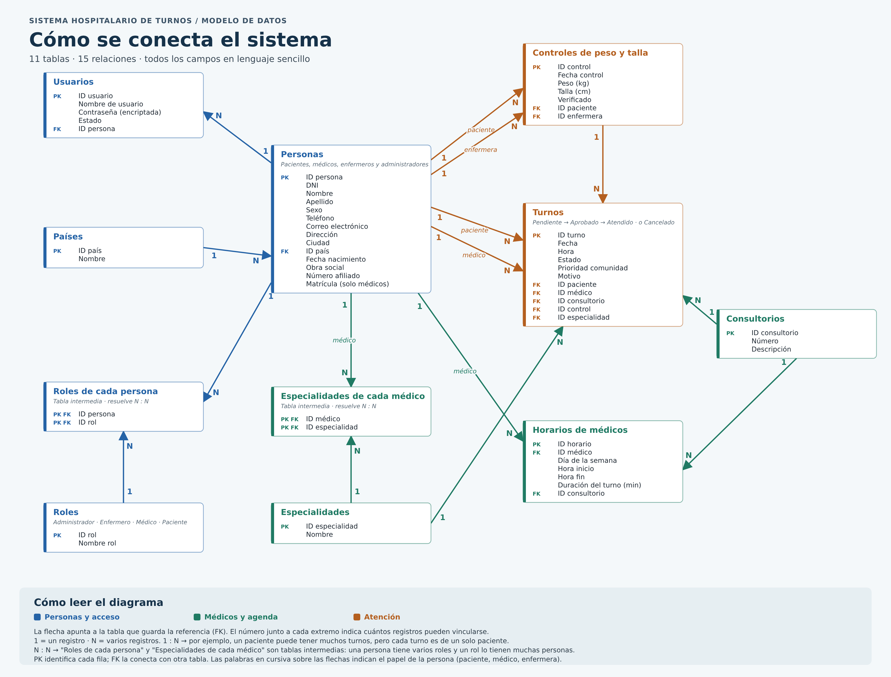

# Base de datos

Motor: **PostgreSQL 16** · Base: `hospital_db` · ORM: **Sequelize 6**.
Las tablas se crean solas desde los modelos (`API/src/models/`) al iniciar la API.

## Diagrama Entidad-Relación



**11 tablas · 15 relaciones.** Las 9 del diagrama original más **PAIS** y **HORARIO_MEDICO**, que agregamos como mejora.

| Grupo | Tablas |
|---|---|
| 🔵 Personas y acceso | `persona`, `usuario`, `rol`, `persona_rol`, `pais` |
| 🟢 Médicos y agenda | `especialidad`, `medico_especialidad`, `horario_medico`, `consultorio` |
| 🟠 Atención | `peso_talla`, `turno` |

## Tablas y columnas

### persona — modelo `Persona.js`
| Columna | Tipo | Clave | Nota |
|---|---|---|---|
| id_persona | INTEGER | PK | Autoincremental |
| dni | VARCHAR(15) | UK | No se repite |
| nombre / apellido | VARCHAR(50) | | Obligatorios |
| sexo | VARCHAR(1) | | M / F / X |
| telefono | VARCHAR(20) | | |
| email | VARCHAR(100) | | Se valida el formato |
| direccion | VARCHAR(100) | | |
| ciudad | VARCHAR(80) | | |
| id_pais | INTEGER | FK → pais | |
| fecha_nacimiento | DATE | | |
| obra_social / numero_afiliado | VARCHAR | | Datos del paciente |
| matricula | VARCHAR(20) | | Datos del médico |

### usuario — `Usuario.js`
| Columna | Tipo | Clave | Nota |
|---|---|---|---|
| id_usuario | INTEGER | PK | |
| nombre_usuario | VARCHAR(50) | UK | |
| contrasena | VARCHAR(255) | | Hash **bcrypt**, nunca se devuelve |
| estado | VARCHAR(20) | | Activo / Inactivo |
| id_persona | INTEGER | FK → persona | |

### rol — `Rol.js`
| Columna | Tipo | Clave |
|---|---|---|
| id_rol | INTEGER | PK |
| nombre_rol | VARCHAR(30) | UK |

### persona_rol — `PersonaRol.js` (resuelve N : N)
| Columna | Tipo | Clave |
|---|---|---|
| id_persona | INTEGER | PK, FK → persona |
| id_rol | INTEGER | PK, FK → rol |

### especialidad — `Especialidad.js`
| Columna | Tipo | Clave |
|---|---|---|
| id_especialidad | INTEGER | PK |
| nombre | VARCHAR(50) | UK |

### medico_especialidad — `MedicoEspecialidad.js` (resuelve N : N)
| Columna | Tipo | Clave |
|---|---|---|
| id_medico | INTEGER | PK, FK → persona |
| id_especialidad | INTEGER | PK, FK → especialidad |

### consultorio — `Consultorio.js`
| Columna | Tipo | Clave |
|---|---|---|
| id_consultorio | INTEGER | PK |
| numero | INTEGER | UK |
| descripcion | VARCHAR(100) | |

### peso_talla — `PesoTalla.js`
| Columna | Tipo | Clave | Nota |
|---|---|---|---|
| id_control | INTEGER | PK | |
| fecha_control | DATE | | |
| peso | DECIMAL | | kg |
| talla | DECIMAL | | cm |
| verificado | BOOLEAN | | Lo marca la enfermera |
| id_paciente | INTEGER | FK → persona | |
| id_enfermera | INTEGER | FK → persona | Quién lo registró |
| imc | (virtual) | | Se calcula en el modelo, no se guarda |

### turno — `Turno.js`
| Columna | Tipo | Clave | Nota |
|---|---|---|---|
| id_turno | INTEGER | PK | |
| fecha | DATE | | |
| hora | TIME | | Se muestra como HH:MM |
| estado | VARCHAR(20) | | Pendiente / Aprobado / Cancelado / Atendido |
| prioridad_comunidad | BOOLEAN | | Pacientes de parajes (Regla 2) |
| motivo | VARCHAR(200) | | |
| id_paciente | INTEGER | FK → persona | |
| id_medico | INTEGER | FK → persona | |
| id_consultorio | INTEGER | FK → consultorio | Lo asigna la enfermera al aprobar |
| id_control | INTEGER | FK → peso_talla | Lo completa el trigger (Regla 3) |
| id_especialidad | INTEGER | FK → especialidad | |

### pais — `Pais.js` ⭐ nueva
| Columna | Tipo | Clave |
|---|---|---|
| id_pais | INTEGER | PK |
| nombre | VARCHAR(60) | UK |

### horario_medico — `HorarioMedico.js` ⭐ nueva
| Columna | Tipo | Clave | Nota |
|---|---|---|---|
| id_horario | INTEGER | PK | |
| id_medico | INTEGER | FK → persona | |
| dia_semana | SMALLINT | | 0 domingo … 6 sábado |
| hora_inicio / hora_fin | TIME | | Se valida que fin > inicio |
| duracion_minutos | SMALLINT | | Largo de cada turno |
| id_consultorio | INTEGER | FK → consultorio | |

## Relaciones (`API/src/models/index.js`)

| # | Relación | Cardinalidad | Sequelize |
|---|---|---|---|
| 1 | pais → persona | 1 : N | `Pais.hasMany(Persona)` |
| 2 | persona → usuario | 1 : N | `Persona.hasMany(Usuario)` |
| 3-4 | persona ↔ rol | N : N | `belongsToMany` por `persona_rol` |
| 5-6 | médico ↔ especialidad | N : N | `belongsToMany` por `medico_especialidad` |
| 7 | médico → horario_medico | 1 : N | `Persona.hasMany(HorarioMedico)` |
| 8 | consultorio → horario_medico | 1 : N | `Consultorio.hasMany(HorarioMedico)` |
| 9 | paciente → peso_talla | 1 : N | alias `controles` / `paciente` |
| 10 | enfermera → peso_talla | 1 : N | alias `enfermera` |
| 11 | paciente → turno | 1 : N | alias `paciente` |
| 12 | médico → turno | 1 : N | alias `medico` |
| 13 | consultorio → turno | 1 : N | alias `consultorio` |
| 14 | peso_talla → turno | 1 : N | alias `control` |
| 15 | especialidad → turno | 1 : N | alias `especialidad` |

## Normalización

- **1FN:** cada columna guarda un solo dato, sin listas.
- **2FN:** las tablas intermedias (`persona_rol`, `medico_especialidad`) usan clave compuesta y no tienen datos que dependan de una sola parte.
- **3FN:** los datos personales están una sola vez en `persona`; país, rol, especialidad y consultorio son catálogos aparte.

## Índices y restricciones

| Índice | Tabla | Para qué |
|---|---|---|
| `ux_persona_dni` | persona | No repetir DNI |
| `ux_usuario_nombre` | usuario | No repetir usuario |
| `ux_rol_nombre`, `ux_especialidad_nombre`, `ux_consultorio_numero`, `ux_pais_nombre` | catálogos | No repetir valores |
| `ux_turno_medico_fecha_hora` (parcial, `estado <> 'Cancelado'`) | turno | Un médico no tiene dos turnos activos a la misma hora |
| `ix_turno_fecha`, `ix_turno_paciente`, `ix_peso_talla_paciente`, `ix_horario_medico` | varias | Búsquedas rápidas |

## Trigger de aprobación (Reglas 1 y 3)

`fn_validar_aprobacion_turno` + `trg_validar_aprobacion_turno` (`BEFORE INSERT OR UPDATE OF estado ON turno`).
Lo crea `seedInicial.js` en cada arranque.

1. Si el turno pasa a **Aprobado**, busca el control **verificado** más reciente del paciente con fecha ≤ fecha del turno.
2. Si no hay ninguno → `RAISE EXCEPTION` y la API responde **400**.
3. Si hay → guarda su `id_control` en el turno.

Así la regla se cumple aunque alguien modifique el turno desde pgAdmin.

## Cómo se crea y se reinicia

| Paso | Archivo | Qué hace |
|---|---|---|
| 1 | `database/crearBase.js` | Crea `hospital_db` si no existe |
| 2 | `config/database.js` | Conecta Sequelize con los datos del `.env` |
| 3 | `sequelize.sync()` | Crea las tablas que falten |
| 4 | `database/seeders/seedInicial.js` | Crea el trigger y carga los datos iniciales |
| — | `npm run db:reset` | Borra todo y lo vuelve a crear |

## Consultas útiles para pgAdmin

```sql
-- Personas con sus roles
SELECT p.nombre, p.apellido, r.nombre_rol
FROM persona p JOIN persona_rol pr USING (id_persona) JOIN rol r USING (id_rol)
ORDER BY p.apellido;

-- Turnos con paciente, médico y control asociado
SELECT t.id_turno, t.fecha, t.hora, t.estado, t.prioridad_comunidad,
       pa.apellido AS paciente, me.apellido AS medico, t.id_control
FROM turno t
JOIN persona pa ON pa.id_persona = t.id_paciente
JOIN persona me ON me.id_persona = t.id_medico
ORDER BY t.fecha, t.hora;

-- Regla 2: turnos con prioridad por día
SELECT fecha, COUNT(*) FILTER (WHERE prioridad_comunidad) AS con_prioridad
FROM turno WHERE estado <> 'Cancelado'
GROUP BY fecha ORDER BY fecha;

-- Ver el trigger
SELECT tgname FROM pg_trigger WHERE tgrelid = 'turno'::regclass AND NOT tgisinternal;
```
