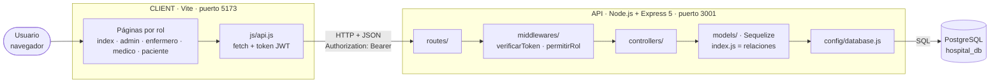
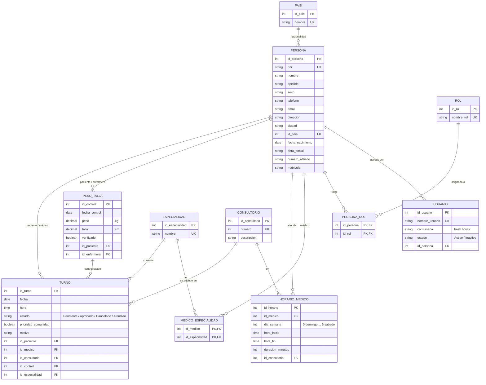
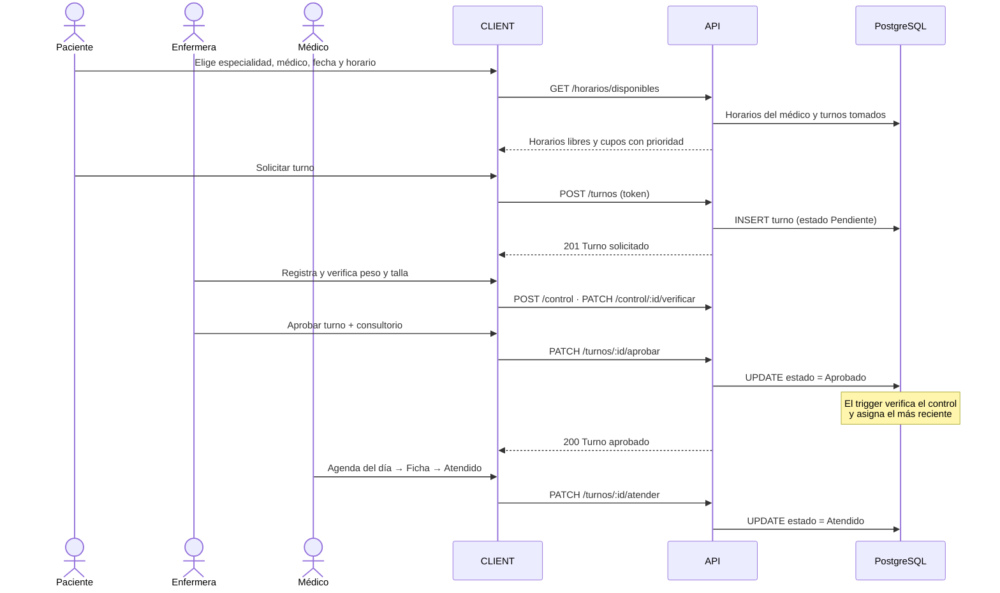

# 🏥 Sistema Hospitalario de Turnos

Sistema web para gestionar los turnos médicos de un hospital, con **4 roles** (Administrador, Enfermero, Médico y Paciente), **prioridad para pacientes de parajes y comunidades lejanas** y **control obligatorio de peso y talla** antes de aprobar cada turno.

| | |
|---|---|
| **Frontend (CLIENT)** | HTML + CSS + JavaScript servido con **Vite** · puerto `5173` |
| **Backend (API)** | **Node.js + Express 5 + Sequelize** · puerto `3001` |
| **Base de datos** | **PostgreSQL** · base `hospital_db` · 11 tablas |
| **Despliegue** | **GitHub** (2 repositorios) + **Render** (base, API y sitio estático) |

---

## Índice

1. [Descripción del proyecto](#1-descripción-del-proyecto)
2. [Proceso de desarrollo](#2-proceso-de-desarrollo)
3. [Requerimientos](#3-requerimientos)
4. [Arquitectura y tecnologías](#4-arquitectura-y-tecnologías)
5. [Estructura de carpetas](#5-estructura-de-carpetas)
6. [Base de datos](#6-base-de-datos)
7. [Backend: la API](#7-backend-la-api)
8. [Frontend: las pantallas](#8-frontend-las-pantallas)
9. [Flujo completo de un turno](#9-flujo-completo-de-un-turno)
10. [Instalación y ejecución local](#10-instalación-y-ejecución-local)
11. [Variables de entorno](#11-variables-de-entorno)
12. [Despliegue en GitHub y Render](#12-despliegue-en-github-y-render)
13. [Trabajo en equipo con Git](#13-trabajo-en-equipo-con-git)
14. [Pruebas](#14-pruebas)
15. [Solución de problemas](#15-solución-de-problemas)
16. [Mejoras futuras](#16-mejoras-futuras)
17. [Equipo](#17-equipo)

---

## 1. Descripción del proyecto

### El problema
- Los turnos se organizan con filas y planillas en papel, sin saber qué horarios quedan libres.
- Los pacientes que viven en **parajes o comunidades lejanas** viajan horas y pueden quedarse sin lugar.
- Se atiende a pacientes **sin un control de peso y talla verificado** previamente.

### La solución
Un sistema web donde:
1. el **paciente** pide su turno eligiendo especialidad, médico, día y horario libre;
2. **enfermería** registra y verifica el control de peso y talla, y aprueba el turno asignando un consultorio;
3. el **médico** ve su agenda, consulta la ficha del paciente y marca el turno como atendido;
4. el **administrador** gestiona personas, roles, horarios, especialidades, consultorios y países, y controla que se cumplan las reglas.

### Objetivo
Cumplir el MVP pedido (turnos con roles y las reglas del diagrama) y superarlo con horarios por médico, ficha del paciente con IMC, panel de estadísticas, registro online de pacientes y despliegue en la nube.

---

## 2. Proceso de desarrollo

El proyecto se construyó en estas etapas:

| Etapa | Qué se hizo | Resultado |
|---|---|---|
| **1. Relevamiento y análisis** | Se partió del diagrama de tablas entregado por el profesor (PERSONA, USUARIO, ROL, PERSONA_ROL, ESPECIALIDAD, MEDICO_ESPECIALIDAD, CONSULTORIO, PESO_TALLA, TURNO) y de sus **reglas del sistema**. Se definieron los roles y qué puede hacer cada uno. | Requerimientos funcionales y reglas de negocio ([sección 3](#3-requerimientos)). |
| **2. Diseño de la base de datos** | Se normalizó el modelo: todas las personas en una sola tabla y los roles en una tabla intermedia. Se agregaron **PAIS** y **HORARIO_MEDICO**, y campos nuevos en PERSONA y TURNO. | DER de 11 tablas ([sección 6](#6-base-de-datos)). |
| **3. Arquitectura** | Siguiendo la consigna, el sistema se separó en **dos proyectos con su propio servidor**: API y CLIENT. Dentro de la API se usó la estructura `config / models / controllers / routes`, con `app.js` como punto de entrada. | Arquitectura en capas ([sección 4](#4-arquitectura-y-tecnologías)). |
| **4. Backend** | Se programaron los modelos de Sequelize (uno por tabla) y sus relaciones en `models/index.js`, los controladores y las rutas. También el login con **JWT**, los permisos por rol, las reglas de negocio y el manejo de errores. | API REST ([sección 7](#7-backend-la-api)). |
| **5. Frontend** | Se diseñó una pantalla de login con elección de rol y una página por cada rol. La conexión con la API está centralizada en `api.js`, e incluye validaciones y diseño responsive. | CLIENT con Vite ([sección 8](#8-frontend-las-pantallas)). |
| **6. Integración con la API de referencia** | Se unificó con la *API Hospitalaria* de referencia del curso. Se adoptaron sus rutas (`/auth`, `/medicos`, `/turnos`, `/control`, `/paises`, `/horarios`), el puerto `3001`, la base `hospital_db`, morgan, nodemon y la creación de tablas con `sequelize.sync()` + seeder. | Una sola API con todo lo anterior. |
| **7. Pruebas** | Pruebas de la base en PostgreSQL (reglas y trigger), pruebas de la API con `api.http` / Postman y recorridos completos de cada rol en el navegador. | Casos de prueba ([sección 14](#14-pruebas)). |
| **8. Despliegue** | Cada proyecto se subió a su propio repositorio de GitHub. En Render, mediante *Blueprints* (`render.yaml`), se crearon la base, la API y el sitio estático. | Sistema publicado en internet ([sección 12](#12-despliegue-en-github-y-render)). |
| **9. Documentación y defensa** | Este README, el DER, el diagrama de arquitectura, la guía de exposición, el tablero Kanban y el stand. | Entrega final. |

### Decisiones técnicas importantes

| Decisión | Por qué |
|---|---|
| Una sola tabla **PERSONA** con roles en **PERSONA_ROL** | Evita duplicar datos (nombre, DNI, contacto). Una persona puede tener más de un rol, por ejemplo médico y paciente. |
| La regla de aprobación en un **trigger de PostgreSQL** | La base la garantiza siempre, aunque alguien modifique un turno desde pgAdmin u otro programa. |
| Reserva de **2 turnos por médico y por día** para parajes | Así siempre hay al menos 2 lugares con prioridad por día, que es lo que pide la regla. |
| **Transacción con bloqueo** al pedir un turno | Evita que dos pacientes tomen el mismo horario al mismo tiempo. |
| `sequelize.sync()` en lugar de `sync({ alter: true })` | Con `alter`, cada reinicio vuelve a crear los índices y se duplican. `sync()` crea solo lo que falta; para recrear todo se usa `npm run db:reset`. |
| **JWT** en lugar de sesiones en el servidor | La API no guarda estado. El token lleva el usuario y su rol, y vale lo mismo en local que en Render. |

---

## 3. Requerimientos

### 3.1 Requerimientos funcionales

| Código | Rol | Requerimiento |
|---|---|---|
| RF-01 | Todos | Iniciar sesión eligiendo el rol con usuario y contraseña. |
| RF-02 | Paciente | Registrarse desde la pantalla de login. |
| RF-03 | Paciente | Pedir un turno eligiendo especialidad, médico, fecha y horario libre, con motivo y prioridad por paraje o comunidad. |
| RF-04 | Paciente | Ver y cancelar sus turnos, ver sus controles de peso y talla y editar sus datos de contacto. |
| RF-05 | Enfermero | Buscar pacientes, registrar controles de peso y talla y verificarlos. |
| RF-06 | Enfermero | Aprobar turnos pendientes asignando un consultorio, o cancelarlos. |
| RF-07 | Médico | Ver su agenda del día y todos sus turnos. |
| RF-08 | Médico | Ver la ficha del paciente (datos, controles con IMC, historial) y marcar el turno como atendido. |
| RF-09 | Médico | Ver sus horarios de atención. |
| RF-10 | Administrador | Ver el resumen del sistema y el control diario de la regla de prioridad (próximos 14 días). |
| RF-11 | Administrador | Dar de alta personas con usuario y roles, cambiar roles, activar o desactivar usuarios y cambiar contraseñas. |
| RF-12 | Administrador | Gestionar especialidades, la asignación de especialidades a médicos, horarios de atención, consultorios y países. |
| RF-13 | Administrador | Ver todos los turnos con filtros por fecha y estado, y cancelarlos. |

### 3.2 Reglas de negocio

| Código | Regla | Dónde se cumple |
|---|---|---|
| **RN-01** | La enfermera solo puede aprobar un turno si existe un registro previo en PESO_TALLA **marcado como verificado**. | Trigger `trg_validar_aprobacion_turno` (PostgreSQL) + botón *Aprobar* desactivado en la pantalla. |
| **RN-02** | Siempre deben existir **al menos 2 turnos por día** con `prioridad_comunidad = TRUE` para pacientes de parajes o comunidades lejanas. | `API/src/utils/agenda.js`: reserva 2 horarios por médico y por día. El administrador lo controla en *Resumen*. |
| **RN-03** | El paciente puede tener varios controles, pero el turno se asocia al **control verificado más reciente**. | El mismo trigger completa `turno.id_control` al aprobar. |
| RN-04 | Un médico no puede tener dos turnos activos en la misma fecha y hora. | Índice único parcial `ux_turno_medico_fecha_hora` + validación en la API. |
| RN-05 | Solo se ofrecen horarios dentro de los días y horas de atención del médico. | Tabla HORARIO_MEDICO + `agenda.js`. |
| RN-06 | Un paciente no puede tener dos turnos con el mismo médico el mismo día. | `turnoController.crear`. |

### 3.3 Requerimientos no funcionales

| Código | Requerimiento |
|---|---|
| RNF-01 | **Seguridad:** contraseñas encriptadas con bcrypt, autenticación con JWT (vence en 8 h) y permisos por rol en cada ruta. |
| RNF-02 | **Integridad:** claves foráneas, índices únicos y trigger en la base de datos. |
| RNF-03 | **Usabilidad:** interfaz clara por rol, mensajes de error comprensibles y autorrelleno en modo demo. |
| RNF-04 | **Responsive:** las pantallas se adaptan al celular. |
| RNF-05 | **Disponibilidad:** sistema publicado en Render y accesible desde internet. |
| RNF-06 | **Mantenibilidad:** separación en capas, un modelo por tabla, código comentado y configuración en `.env`. |

---

## 4. Arquitectura y tecnologías

Arquitectura **cliente-servidor en capas**, con dos proyectos independientes:



**Recorrido de un pedido:** `ruta → middleware (¿token? ¿rol?) → controlador (lógica) → modelo (Sequelize) → PostgreSQL → respuesta JSON`.

### Tecnologías y justificación

| Tecnología | Uso | Por qué |
|---|---|---|
| **Node.js** | Entorno del backend | JavaScript en el frontend y en el backend: un solo lenguaje para todo el equipo. |
| **Express 5** | Framework de la API | Estándar para APIs REST, simple y con middlewares para seguridad y errores. |
| **PostgreSQL** | Base de datos | Relacional, gratuita y robusta. Soporta claves foráneas, índices y triggers. |
| **Sequelize 6** | ORM | Un modelo por tabla, relaciones declaradas en un solo archivo y consultas protegidas contra inyección SQL. |
| **jsonwebtoken (JWT)** | Autenticación | Sesión sin estado: el token lleva el id, el nombre y el rol del usuario. |
| **bcryptjs** | Contraseñas | Guarda las contraseñas encriptadas (hash). |
| **dotenv** | Configuración | Mantiene las contraseñas y claves fuera del código. |
| **cors** | Seguridad HTTP | Permite que el CLIENT (otro origen) consuma la API. |
| **morgan** | Logs | Muestra cada pedido en la consola (`GET /turnos 200 - 12 ms`). |
| **nodemon** | Desarrollo | Reinicia la API al guardar cambios. |
| **Vite** | Servidor del frontend | Arranque rápido en desarrollo y build optimizado para producción. |
| **GitHub** | Control de versiones | Historial, ramas, Pull Requests y tablero Kanban. |
| **Render** | Hosting | Publica gratis la base, la API y el sitio, y se actualiza con cada `git push`. |

---

## 5. Estructura de carpetas

```
sistema-hospital/
├── .vscode/                           ← F5 "Iniciar todo", conexión SQLTools, extensiones
├── README.md                          ← este documento
│
├── API/                               ← BACKEND (repositorio propio)
│   ├── .env · .env.example            ← configuración (la de .env no se sube a GitHub)
│   ├── .gitignore
│   ├── package.json                   ← npm start · npm run dev · npm run db:reset
│   ├── render.yaml                    ← Blueprint: base PostgreSQL + servicio de la API
│   ├── api.http                       ← ejemplos para probar cada ruta (REST Client)
│   └── src/
│       ├── app.js                     ← dispara el servidor y define las rutas (app.use)
│       ├── config/
│       │   ├── index.js               ← require('./config') devuelve la conexión
│       │   └── database.js            ← conexión Sequelize ↔ PostgreSQL
│       ├── models/                    ← UN modelo por tabla (mayúscula y singular)
│       │   ├── Persona.js  Usuario.js  Rol.js  PersonaRol.js  Pais.js
│       │   ├── Especialidad.js  MedicoEspecialidad.js  HorarioMedico.js
│       │   ├── Consultorio.js  PesoTalla.js  Turno.js
│       │   └── index.js               ← TODAS las relaciones entre tablas
│       ├── controllers/               ← lógica de cada recurso
│       ├── routes/                    ← auth · medicos · turnos · control · paises · horarios
│       │                                 especialidades · consultorios · personas · usuarios
│       │                                 estadisticas · perfil
│       ├── middlewares/
│       │   ├── auth.js                ← verificarToken · permitirRol
│       │   └── errores.js             ← traduce errores a mensajes y códigos HTTP
│       ├── utils/
│       │   ├── agenda.js              ← horarios disponibles y cupos de prioridad
│       │   ├── roles.js               ← consultas de roles
│       │   └── turnos.js              ← consulta de turnos con sus datos relacionados
│       └── database/
│           ├── crearBase.js           ← crea hospital_db si no existe
│           ├── reset.js               ← npm run db:reset (borra y recrea todo)
│           └── seeders/seedInicial.js ← trigger de aprobación + datos iniciales
│
└── CLIENT/                            ← FRONTEND (repositorio propio)
    ├── .env · .env.example            ← VITE_API_URL
    ├── package.json                   ← npm run dev · npm run build
    ├── vite.config.js                 ← sitio de varias páginas
    ├── render.yaml                    ← Blueprint: sitio estático
    ├── index.html                     ← login con los 4 roles
    ├── admin.html · enfermero.html · medico.html · paciente.html
    └── public/
        ├── css/styles.css             ← colores por rol, diseño responsive
        └── js/
            ├── config.js              ← URL de la API y modo demo
            ├── api.js                 ← conexión con la API, sesión y utilidades
            └── login.js · admin.js · enfermero.js · medico.js · paciente.js
```

---

## 6. Base de datos

### 6.1 Diagrama Entidad-Relación (DER)

Son 11 tablas: las 9 del diagrama original más **PAIS** y **HORARIO_MEDICO**.



### 6.2 Descripción de las tablas

| Tabla | Modelo | Descripción |
|---|---|---|
| `persona` | `Persona` | Datos personales de todas las personas: pacientes, médicos, enfermeros y administradores. |
| `usuario` | `Usuario` | Credenciales de acceso. La contraseña se guarda como hash bcrypt. |
| `rol` | `Rol` | Catálogo: Administrador, Enfermero, Médico, Paciente. |
| `persona_rol` | `PersonaRol` | Asigna roles a las personas (relación N a N). |
| `especialidad` | `Especialidad` | Catálogo de especialidades médicas. |
| `medico_especialidad` | `MedicoEspecialidad` | Especialidades de cada médico (relación N a N). |
| `consultorio` | `Consultorio` | Consultorios disponibles. |
| `peso_talla` | `PesoTalla` | Controles de peso y talla. Indica quién lo registró y si está verificado. El IMC se calcula en el modelo. |
| `turno` | `Turno` | Turnos con su estado, prioridad, motivo y el control asociado. |
| `pais` | `Pais` | *(Mejora)* Catálogo de países. |
| `horario_medico` | `HorarioMedico` | *(Mejora)* Días y horas de atención de cada médico. |

### 6.3 Relaciones (`API/src/models/index.js`)

| Relación | Sequelize |
|---|---|
| PERSONA 1 — N USUARIO | `Persona.hasMany(Usuario)` · `Usuario.belongsTo(Persona)` |
| PERSONA N — N ROL | `belongsToMany` a través de `PersonaRol` |
| PERSONA (médico) N — N ESPECIALIDAD | `belongsToMany` a través de `MedicoEspecialidad` |
| PERSONA 1 — N PESO_TALLA | Dos veces: como `paciente` y como `enfermera` |
| TURNO N — 1 PERSONA / CONSULTORIO / PESO_TALLA / ESPECIALIDAD | `Turno.belongsTo(...)` con alias `paciente`, `medico`, `consultorio`, `control`, `especialidad` |
| PAIS 1 — N PERSONA | `Pais.hasMany(Persona)` |
| PERSONA 1 — N HORARIO_MEDICO | `Persona.hasMany(HorarioMedico)` |

### 6.4 Índices y restricciones

| Índice | Tabla | Para qué |
|---|---|---|
| `ux_persona_dni` (único) | persona | No repetir DNI. |
| `ux_usuario_nombre` (único) | usuario | No repetir nombre de usuario. |
| `ux_rol_nombre`, `ux_especialidad_nombre`, `ux_consultorio_numero`, `ux_pais_nombre` (únicos) | catálogos | No repetir valores. |
| `ux_turno_medico_fecha_hora` (único **parcial**, `estado <> 'Cancelado'`) | turno | Un médico no puede tener dos turnos activos a la misma hora (RN-04). |
| `ix_turno_fecha`, `ix_turno_paciente` | turno | Acelerar las búsquedas por fecha y por paciente. |
| `ix_peso_talla_paciente` | peso_talla | Buscar rápido el último control de un paciente. |
| `ix_horario_medico` | horario_medico | Buscar los horarios de un médico por día. |

### 6.5 Trigger de aprobación (RN-01 y RN-03)

Lo crea `seedInicial.js` en cada arranque, de forma idempotente:

```sql
CREATE OR REPLACE FUNCTION fn_validar_aprobacion_turno() RETURNS TRIGGER AS $$
DECLARE v_control INT;
BEGIN
  IF NEW.estado = 'Aprobado' AND (TG_OP = 'INSERT' OR OLD.estado IS DISTINCT FROM 'Aprobado') THEN
    SELECT id_control INTO v_control FROM peso_talla
     WHERE id_paciente = NEW.id_paciente AND verificado = TRUE AND fecha_control <= NEW.fecha
     ORDER BY fecha_control DESC, id_control DESC LIMIT 1;          -- el más reciente
    IF v_control IS NULL THEN
      RAISE EXCEPTION 'No se puede aprobar el turno: el paciente no tiene un control de peso y talla verificado.';
    END IF;
    NEW.id_control := v_control;                                      -- se asocia solo
  END IF;
  RETURN NEW;
END; $$ LANGUAGE plpgsql;

CREATE TRIGGER trg_validar_aprobacion_turno
BEFORE INSERT OR UPDATE OF estado ON turno
FOR EACH ROW EXECUTE FUNCTION fn_validar_aprobacion_turno();
```

### 6.6 Cómo se crea la base

Al iniciar la API (`npm run dev`):

1. `crearBase.js` crea la base `hospital_db` si no existe.
2. `sequelize.authenticate()` prueba la conexión.
3. `sequelize.sync()` crea las tablas que falten a partir de los modelos.
4. `seedInicial()` crea el trigger y, si la base está vacía, carga los datos iniciales.

`npm run db:reset` borra todas las tablas, las crea de nuevo y vuelve a cargar los datos iniciales.

### 6.7 Datos iniciales (seeder)

| Dato | Contenido |
|---|---|
| Roles | Administrador, Enfermero, Médico, Paciente |
| Países | Argentina, Bolivia, Brasil, Chile, Paraguay, Perú, Uruguay, Venezuela, Otro |
| Especialidades | Clínica Médica, Pediatría, Cardiología, Ginecología, Traumatología |
| Consultorios | 101, 102, 201, 202, 203 |
| Médicos | `med001` a `med005`, con matrícula, especialidades y horarios de atención |
| Pacientes | `juan` (de un paraje, con controles verificados) y `sofia` (con un control sin verificar) |
| Turnos | 2 turnos pendientes para el día siguiente |

---

## 7. Backend: la API

### 7.1 Arranque (`src/app.js`)

```
express.json() → cors() → morgan('dev') → rutas (app.use) → 404 → manejarErrores
crearBase → authenticate → sync() → seedInicial() → app.listen(3001)
```

### 7.2 Autenticación y permisos

1. `POST /auth/login` recibe `{ "usuario", "contraseña", "rol"? }`.
2. El controlador busca el usuario y compara la contraseña con **bcrypt**. Después verifica que el usuario esté activo y que tenga el rol pedido. Si no se envía un rol, entra con el principal.
3. Devuelve un **token JWT** firmado con `JWT_SECRET`, que vence en 8 horas:

```json
{
  "ok": true,
  "token": "eyJhbGciOi...",
  "user": { "id_usuario": 1, "id_persona": 1, "usuario": "admin", "nombre": "Laura Gómez", "rol": "admin", "roles": ["admin"] }
}
```

4. Cada pedido privado envía el header `Authorization: Bearer <token>`.
5. `verificarToken` valida el token y `permitirRol('enfermero', ...)` controla el rol.

### 7.3 Rutas

> 🔓 público · 🔐 requiere sesión · entre paréntesis, los roles permitidos

**Rutas de la API de referencia**

| Método | Ruta | Acceso | Descripción |
|---|---|---|---|
| GET | `/` | 🔓 | Estado de la API y lista de rutas |
| GET | `/health` | 🔓 | Prueba la conexión con la base |
| POST | `/auth/login` | 🔓 | Iniciar sesión → token |
| POST | `/auth/registro-paciente` | 🔓 | Alta de paciente |
| GET | `/auth/me` | 🔐 | Datos del token |
| GET | `/medicos?especialidad=` | 🔓 | Médicos con sus especialidades |
| POST | `/medicos/login` | 🔓 | Login de médicos |
| GET | `/medicos/:id` | 🔓 | Médico con especialidades y horarios |
| GET | `/medicos/:id/turnos?fecha=&estado=` | 🔐 (médico propio, enfermero, admin) | Agenda del médico |
| GET | `/medicos/:id/pacientes/:idPaciente` | 🔐 (médico, admin) | Ficha del paciente |
| POST · DELETE | `/medicos/:id/especialidades[/:idEsp]` | 🔐 (admin) | Asignar o quitar especialidad |
| GET | `/turnos?fecha=&estado=&id_medico=&id_paciente=` | 🔐 | Turnos (paciente y médico ven solo los suyos) |
| POST | `/turnos` | 🔐 (paciente) | Solicitar turno |
| PATCH | `/turnos/:id/aprobar` | 🔐 (enfermero) | Aprobar con consultorio (RN-01) |
| PATCH | `/turnos/:id/cancelar` | 🔐 (paciente, enfermero, admin) | Cancelar |
| PATCH | `/turnos/:id/atender` | 🔐 (médico) | Marcar como atendido |
| GET | `/turnos/prioridad` | 🔐 (admin) | Control de RN-02 en los próximos 14 días |
| GET | `/control?id_paciente=` | 🔐 | Controles de peso y talla |
| POST | `/control` | 🔐 (enfermero) | Registrar control |
| PATCH | `/control/:id/verificar` | 🔐 (enfermero) | Verificar control |
| GET | `/paises` | 🔓 | Lista de países |
| POST · DELETE | `/paises[/:id]` | 🔐 (admin) | Agregar o eliminar país |
| GET | `/horarios?id_medico=` | 🔓 | Horarios de atención |
| GET | `/horarios/disponibles?id_medico=&fecha=` | 🔐 | Horarios libres de un día |
| POST · DELETE | `/horarios[/:id]` | 🔐 (admin) | Cargar o quitar horario |

**Rutas que usan los paneles**

| Método | Ruta | Acceso | Descripción |
|---|---|---|---|
| GET · POST · DELETE | `/especialidades` | 🔓 lectura / 🔐 admin | Especialidades |
| GET · POST · DELETE | `/consultorios` | 🔐 / 🔐 admin | Consultorios |
| GET | `/personas?q=&rol=` | 🔐 (admin; enfermero solo pacientes) | Personas con roles |
| POST · PUT | `/personas`, `/personas/:id`, `/personas/:id/roles` | 🔐 (admin) | Alta, edición y roles |
| GET · PATCH | `/usuarios/roles`, `/usuarios/:id/estado`, `/usuarios/:id/contrasena` | 🔐 (admin) | Roles, estado y contraseña |
| GET | `/estadisticas/resumen` | 🔐 (admin) | Números del panel |
| GET · PUT | `/perfil` | 🔐 | Datos propios |

### 7.4 Ejemplo: solicitar un turno

```http
POST http://localhost:3001/turnos
Authorization: Bearer <token del paciente>
Content-Type: application/json

{
  "id_medico": 3,
  "id_especialidad": 1,
  "fecha": "2026-12-01",
  "hora": "10:00",
  "motivo": "Dolor de cabeza",
  "prioridad_comunidad": false
}
```

Antes de crear el turno, la API valida:
- que la fecha no sea pasada;
- que el médico atienda esa especialidad;
- que el día y el horario estén dentro de su agenda;
- que el horario esté libre;
- que el paciente no tenga otro turno con ese médico ese día;
- que, si el turno no tiene prioridad, no ocupe uno de los 2 cupos reservados (RN-02).

### 7.5 Códigos de respuesta y manejo de errores

`middlewares/errores.js` convierte cada error en un mensaje claro:

| Código | Cuándo |
|---|---|
| **200 / 201** | Operación correcta / registro creado |
| **400** | Dato inválido o regla no cumplida (por ejemplo, aprobar sin control verificado) |
| **401** | Sin sesión o token vencido |
| **403** | El rol no tiene permiso |
| **404** | Ruta o registro inexistente |
| **409** | Duplicado (DNI, usuario) u horario ya tomado |
| **503** | PostgreSQL apagado, contraseña incorrecta o base inexistente |
| **500** | Error inesperado (se registra en la consola) |

---

## 8. Frontend: las pantallas

### 8.1 Páginas

| Página | Rol | Secciones |
|---|---|---|
| `index.html` | Todos | Login con elección de rol, autorrelleno (modo demo) y registro de pacientes |
| `admin.html` | Administrador | Resumen y regla de prioridad · Personas y usuarios · Médicos y especialidades · Horarios · Consultorios y países · Turnos |
| `enfermero.html` | Enfermero | Turnos pendientes (aprobar o cancelar) · Peso y talla · Turnos del día |
| `medico.html` | Médico | Agenda del día · Mis turnos · Mis horarios · Ficha del paciente |
| `paciente.html` | Paciente | Pedir turno · Mis turnos · Mis controles · Mis datos |

Cada rol tiene su propio color: azul para el administrador, ámbar para el enfermero, verde azulado para el médico y violeta para el paciente.

### 8.2 Conexión con la API (`public/js/api.js`)

- `api(ruta, { method, body })` hace el `fetch` a `VITE_API_URL`, agrega el token y lanza el mensaje de error de la API.
- `Auth` guarda el token y el usuario en `localStorage`. Si la API responde 401, cierra la sesión.
- `guard('paciente')` impide abrir la página de otro rol. La seguridad real igual está en la API.
- Incluye utilidades compartidas: `toast()` para avisos, `modal()`, `tabla()` y formateo de fechas.

### 8.3 Validaciones en el frontend
- Campos obligatorios, formato de email, contraseña de al menos 6 caracteres y longitudes máximas.
- No se pueden elegir fechas pasadas.
- Los horarios ocupados aparecen tachados, y hay un aviso de los cupos reservados para pacientes con prioridad.
- Se avisa qué días atiende el médico si el elegido no tiene agenda.
- El botón *Aprobar* se desactiva si el paciente no tiene un control verificado.

Todas estas validaciones **se repiten en la API**, porque el frontend se puede saltear.

### 8.4 Modo demo
En `public/js/config.js`, `MODO_DEMO: true` completa el usuario y la contraseña de prueba al elegir un rol. **Para usar el sistema con datos reales, cambiarlo a `false`.**

---

## 9. Flujo completo de un turno



**Estados de un turno:** `Pendiente → Aprobado → Atendido`. Desde *Pendiente* o *Aprobado* también puede pasar a `Cancelado`.

---

## 10. Instalación y ejecución local

### Requisitos
- [Node.js](https://nodejs.org) 18 o superior (recomendado: LTS)
- [PostgreSQL](https://www.postgresql.org/download/) con pgAdmin
- Opcional: Visual Studio Code y Git

### Paso previo
En `API/.env`, poner en `DB_PASSWORD` la contraseña de tu PostgreSQL.

### Opción A: terminal (Windows, Mac o Linux)
```bash
# Terminal 1: API
cd API
npm install
npm run dev          # http://localhost:3001

# Terminal 2: CLIENT
cd CLIENT
npm install
npm run dev          # http://localhost:5173
```

En la consola de la API tiene que aparecer:
```
Conectado a PostgreSQL
Tablas sincronizadas
Datos iniciales cargados (...)
Servidor escuchando en puerto 3001
```

### Opción B: VS Code
*Archivo → Abrir carpeta* → *Ejecutar y depurar* → **"▶ Iniciar todo (API + CLIENT)"** → F5.

### Ver la base en pgAdmin
*Servers → PostgreSQL → Databases → hospital_db → Schemas → public → Tables* → clic derecho en una tabla → *View/Edit Data*.

### Scripts disponibles

| Carpeta | Comando | Qué hace |
|---|---|---|
| API | `npm run dev` | Inicia la API con nodemon |
| API | `npm start` | Inicia la API (producción) |
| API | `npm run db:reset` | Borra y recrea las tablas con los datos iniciales |
| CLIENT | `npm run dev` | Servidor de desarrollo de Vite |
| CLIENT | `npm run build` | Genera la versión final en `dist/` |
| CLIENT | `npm run preview` | Sirve la versión de `dist/` |

### Usuarios de prueba

| Rol | Usuario | Contraseña |
|---|---|---|
| Administrador | `admin` | `admin123` |
| Médicos | `med001` … `med005` | `med123` |
| Enfermera | `enfermera` | `enfermera123` |
| Pacientes | `juan`, `sofia` | `paciente123` |

---

## 11. Variables de entorno

### API (`API/.env`)

| Variable | Ejemplo | Descripción |
|---|---|---|
| `DB_NAME` | `hospital_db` | Nombre de la base |
| `DB_USER` | `postgres` | Usuario de PostgreSQL |
| `DB_PASSWORD` | `****` | Contraseña de PostgreSQL |
| `DB_HOST` / `DB_PORT` | `localhost` / `5432` | Servidor de PostgreSQL |
| `PORT` | `3001` | Puerto de la API |
| `JWT_SECRET` | `una_clave_larga` | Clave para firmar los tokens |
| `JWT_EXPIRES` | `8h` | Duración de la sesión |
| `CORS_ORIGIN` | `*` | Origen permitido para el CLIENT |
| `CUPOS_PRIORIDAD` | `2` | Turnos reservados por médico y por día |
| `DATABASE_URL` | `postgres://...` | *(Render / Supabase)* Reemplaza a `DB_*` |
| `DB_SSL` | `true` / `false` | SSL para conectarse a una base externa |

### CLIENT (`CLIENT/.env`)

| Variable | Ejemplo | Descripción |
|---|---|---|
| `VITE_API_URL` | `http://localhost:3001` | Dirección de la API (en Render: la URL del servicio) |

> ⚠️ Los archivos `.env` están en `.gitignore` y **no se suben a GitHub**. En el repositorio solo va `.env.example`.

---

## 12. Despliegue en GitHub y Render

### 12.1 GitHub (dos repositorios)
```bash
cd API
git init && git add . && git commit -m "feat: API hospitalaria"
git branch -M main
git remote add origin https://github.com/USUARIO/api-hospital.git
git push -u origin main

cd ../CLIENT
git init && git add . && git commit -m "feat: client hospital"
git branch -M main
git remote add origin https://github.com/USUARIO/client-hospital.git
git push -u origin main
```

### 12.2 Render
1. **API + base de datos:** *New → Blueprint →* repositorio `api-hospital`.
   - `API/render.yaml` crea la base PostgreSQL `turnero-db` y el servicio `turnero-api`.
   - Configura solas las variables `DATABASE_URL` y `JWT_SECRET` (esta se genera automáticamente).
   - En el primer arranque se crean las tablas y los datos iniciales.
   - Para comprobarlo, abrir `https://<api>.onrender.com/health`.
2. **CLIENT:** *New → Blueprint →* repositorio `client-hospital` → cargar `VITE_API_URL` con la URL de la API, sin `/` al final.
3. **Actualizaciones:** cada `git push` a `main` vuelve a publicar automáticamente.

> **Plan gratis de Render:** la API se duerme después de 15 minutos sin uso y tarda alrededor de un minuto en despertar. La base gratis vence a los 30 días de creada.

---

## 13. Trabajo en equipo con Git

### Flujo de trabajo
1. Cada integrante trabaja en su rama: `feature/base-datos`, `feature/turnos`, `feature/frontend`, `feature/docs-deploy`, etc.
2. Commits chicos con mensajes claros:
   - `feat:` nueva funcionalidad, por ejemplo `feat: validar DNI en el registro`
   - `fix:` corrección
   - `docs:` documentación
   - `style:` estilos
   - `refactor:` reorganización de código
3. `git push -u origin feature/mi-rama` → se abre un **Pull Request** en GitHub.
4. Otro integrante **revisa y aprueba** el PR, y se hace el merge a `main`.

```bash
git checkout -b feature/mi-rama
git add .
git commit -m "feat: descripción del cambio"
git push -u origin feature/mi-rama
```

### Tablero Kanban
En GitHub: *Projects → New project → Board*, con las columnas **Por hacer · En curso · En revisión · Hecho**. Cada tarea es un *issue* asignado a un integrante.

---

## 14. Pruebas

### 14.1 Casos de prueba funcionales

| N° | Caso | Pasos | Resultado esperado |
|---|---|---|---|
| CP-01 | Login correcto | Rol Paciente → `juan / paciente123` | Entra a la pantalla del paciente |
| CP-02 | Login con rol equivocado | Rol Médico → `juan / paciente123` | "Este usuario no tiene el rol Médico" |
| CP-03 | Pedir turno | Paciente → especialidad, médico, fecha, horario, motivo → Solicitar | Turno *Pendiente* en "Mis turnos" |
| CP-04 | Horario tomado | Pedir un horario que ya está ocupado | El horario aparece tachado. Por API: 409 |
| CP-05 | Cupos reservados (RN-02) | Llenar la agenda de un día sin marcar prioridad | Los últimos 2 horarios solo están disponibles con prioridad |
| CP-06 | Aprobar sin control (RN-01) | Enfermero → turno de Sofía | Botón desactivado. Por API: 400 con el mensaje de la regla |
| CP-07 | Aprobar con control (RN-03) | Verificar el control de Sofía → Aprobar con consultorio | Turno *Aprobado*, asociado al control más reciente |
| CP-08 | Atender | Médico → Agenda → Marcar atendido | Turno *Atendido* |
| CP-09 | Sin sesión | `GET /turnos` sin token | 401 |
| CP-10 | Sin permiso | Paciente → `GET /personas` | 403 |
| CP-11 | Duplicado | Registrar dos veces el mismo DNI | 409 "registro duplicado" |
| CP-12 | Responsive | Abrir la página en el celular | Menús y tablas se adaptan |

### 14.2 Pruebas de la API
El archivo `API/api.http` tiene ejemplos listos para ejecutar con la extensión **REST Client** de VS Code. También se puede usar **Postman** o **Thunder Client**.

---

## 15. Solución de problemas

| Mensaje | Causa | Solución |
|---|---|---|
| *No se pudo conectar con el servidor* | La API no está corriendo | `npm run dev` en `API` |
| *ECONNREFUSED / No se pudo conectar a PostgreSQL* | PostgreSQL está apagado | Iniciar el servicio (Windows: *Servicios → postgresql*) |
| *password authentication failed* | `DB_PASSWORD` incorrecta | Corregirla en `API/.env` |
| *database "hospital_db" does not exist* | El usuario no tiene permiso para crear bases | En pgAdmin: `CREATE DATABASE hospital_db;` |
| *Cannot find module ...* | Faltan las dependencias | `npm install` en la carpeta correspondiente |
| *La ejecución de scripts está deshabilitada* (PowerShell) | Política de Windows | `Set-ExecutionPolicy -Scope CurrentUser RemoteSigned` |
| *Este usuario no tiene el rol…* | Se eligió otro rol | Elegir el rol correcto en el login |
| La página en Render tarda en cargar | La API gratis estaba dormida | Esperar alrededor de un minuto |
| Datos desordenados tras las pruebas | — | `npm run db:reset` en `API` |

---

## 16. Mejoras futuras

- Avisos del turno por **WhatsApp o email** (recordatorios para pacientes de parajes).
- Bloqueo automático de **feriados**.
- **Pruebas automáticas** de la API (Jest + Supertest).
- **Reportes** y gráficos de atención por especialidad y por médico.
- Recuperación de contraseña por email.

---

## 17. Equipo

| Integrante | Área |
|---|---|
| [Nombre y apellido] | Arquitectura y tecnologías |
| [Nombre y apellido] | Base de datos |
| [Nombre y apellido] | Backend (API) |
| [Nombre y apellido] | Frontend |
| [Nombre y apellido] | Despliegue y documentación |

**[Carrera] · [Instituto] · Proyecto Integrador 2026**
